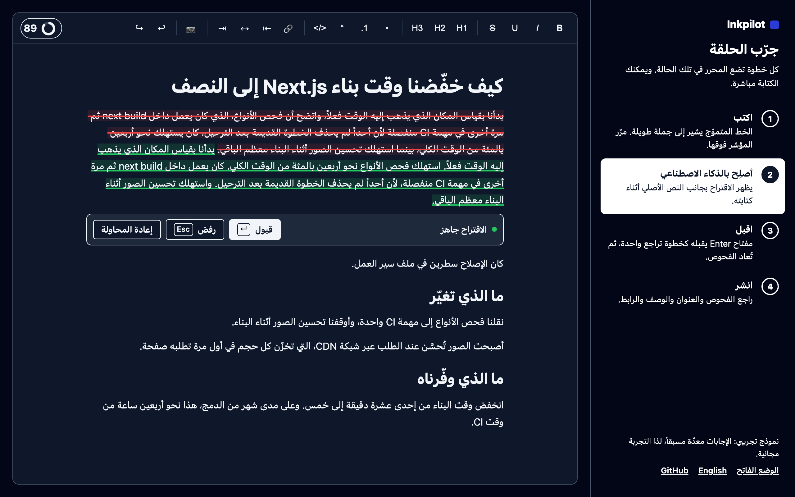

# Internationalization

UI strings use flat keys (`toolbar.bold`, `rewrite.accept`, `seo.issue.long-sentence`). English ships with the package. Pass any subset to override:

```tsx
<Editor
  locale="de"
  i18n={{ translations: { 'toolbar.bold': 'Fett', 'rewrite.accept': 'Übernehmen' } }}
/>
```

Missing keys fall back to English.

## Placeholders

Some strings take values in braces:

```ts
'seo.issue.long-sentence.detail': 'The longest sentence has {words} words. Readers lose track past about {limit}.'
```

Keep the placeholder names when translating. Every SEO issue has a short label (`seo.issue.<code>`) and a detail line (`seo.issue.<code>.detail`), filled from the issue's params.

## Content language vs UI language

`locale` sets the UI language and, by default, the language the checks assume for sentence splitting. If you write in one language and run the UI in another, set `seo.locale`. The reading-ease check runs for English only.

## Right-to-left



Set `dir="rtl"` on a container. The editor, issue popover and publish panel use logical CSS properties and mirror.
