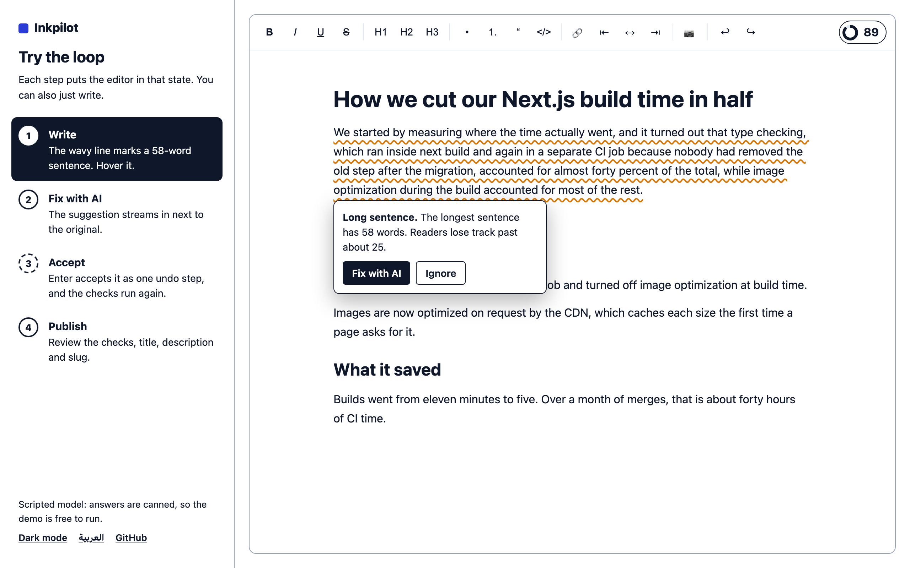
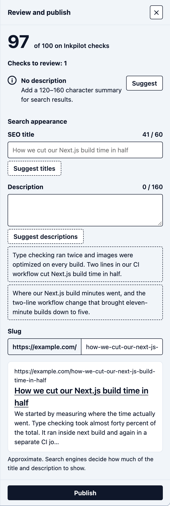

# SEO

## The checks

One engine (`analyzeDocument`) runs on the document. It is pure and synchronous. While you write it runs 400 ms after typing stops, and it runs once more on the exact content being published.

<picture>
  <source media="(prefers-color-scheme: dark)" srcset="screenshots/issue-dark.png">
  
</picture>

| Code | Severity | Range | Fix |
|---|---|---|---|
| `missing-title` | error | | add an H1 or SEO title |
| `multiple-h1` | warning | extra H1 | manual |
| `heading-skip` | warning | heading | manual |
| `title-length` | info | H1 | AI title suggestions |
| `generic-title` | warning | H1 | AI title suggestions |
| `description-missing`, `description-length` | info | | AI description suggestions |
| `alt-missing` | warning | image | AI alt text |
| `alt-length` | info | image | AI alt text |
| `inline-image` | info | image | configure uploads |
| `long-sentence` | warning | paragraph | Fix with AI |
| `dense-paragraph` | info | paragraph | Fix with AI (may split it) |
| `hard-to-read` | info | | English only |
| `keyword-missing` | warning | first paragraph | Fix with AI |
| `keyword-not-in-intro` | info | first paragraph | Fix with AI |
| `keyword-not-in-title` | info | H1 | AI title suggestions |
| `keyword-not-in-headings` | info | | manual |
| `keyword-density` | warning if too high | | manual |

Sentences and words are split with `Intl.Segmenter` for the content language (`seo.locale`, else `locale`). It treats abbreviations like "Dr." as sentence ends. Keywords match whole words in any script, so "react" doesn't match "reactive". Description checks only run when the publish panel is on, because the panel is where you write the description.

## Thresholds are guidance

```ts
const DEFAULT_RULE_OPTIONS = {
  titleLength: { min: 30, max: 60 },
  descriptionLength: { min: 120, max: 160 },
  altLength: { min: 5, max: 125 },
  maxSentenceWords: 25,
  maxParagraphSentences: 5,
  minReadingEase: 50,
  keywordDensity: { min: 0.005, max: 0.03 },
};

<Editor seo={{ rules: { maxSentenceWords: 30, titleLength: { min: 20, max: 70 } } }} />
```

Search engines don't publish fixed title or description limits. What shows depends on pixel width and device. That's why length findings are `info`, and the search preview in the panel says it is approximate.

## The score

`100 - penalties`: error 15, warning 8, info 3. One code can cost at most 24 points, so ten long sentences don't sink the score by themselves. Read the score as "how well this meets Inkpilot's checks". It doesn't predict ranking.

## Fixing issues

Hover an underlined issue to see what's wrong. Fix with AI starts a rewrite of that range with an issue-specific instruction, for example "split the long sentences, keep every fact". Ignore hides the issue until its text changes.

The publish panel lists every issue with the action that fits it: Fix (AI rewrite or alt text), Suggest (title or description ideas), or Show (selects the text).

From code:

```ts
editor.commands.fixIssue(issue.id);     // false if it can't be fixed with AI
editor.commands.ignoreIssue(issue.id);
editor.commands.refreshReport();        // after changing inputs outside the editor
```

## Publishing

<picture>
  <source media="(prefers-color-scheme: dark)" srcset="screenshots/publish-panel-dark.png">
  
</picture>

`onPublish({ content, meta, report })`:

- `content` and `report` come from the same document state. If you edit and publish within the debounce window, the report still matches.
- `meta` is `{ title, description, slug }`. An empty `title` means the H1 is the title. The slug follows the title until it's edited.
- Publishing is refused while images upload or if a local preview is left.

Use `defaultMeta` to load saved metadata and `onMetaChange` to keep it in your state.
